# GCP Cloud Security Posture Management (CSPM) Automation


## Executive Summary

A cloud security posture management tool for Google Cloud, **deployed 100% with Terraform**. It scans a project for storage misconfigurations, classifies findings by severity, and can fix them automatically behind several safety controls (dry-run by default, an allowlist, idempotency, before/after capture). Every action lands in an audit trail in BigQuery.

On top of the pipeline sits a **read-only Posture Advisor Agent** (Google ADK with Gemini). It answers questions about the findings in plain English, drafts suggested fixes as text, and is built so that it **cannot change anything**: it has no write permissions, a hard cap on tool calls, schema-validated answers, and a full audit log.

Everything validates in CI **without any GCP credentials**: Terraform format and validate, Checkov in strict mode, 54 unit tests, and a gitleaks scan of the full git history.

## Table of Contents

1. [What it does](#what-it-does)
2. [Architecture](#architecture)
3. [Tech stack](#tech-stack)
4. [Quickstart](#quickstart)
5. [Infrastructure as Code](#infrastructure-as-code)
6. [CI and Security Checks](#ci-and-security-checks)
7. [End-to-end validation](#end-to-end-validation)
8. [Posture Advisor Agent](#posture-advisor-agent)
9. [Agent Governance](#agent-governance)
10. [Security Design Decisions](#security-design-decisions)
11. [Known limitations](#known-limitations)
12. [Debugging stories](#debugging-stories)
13. [At enterprise scale I would add](#at-enterprise-scale-i-would-add)
14. [Teardown](#teardown)
15. [License](#license)

## What it does

| Layer | Component | Job |
|---|---|---|
| Detect | `scanner` | Reads Cloud Asset Inventory (with a Cloud Storage API fallback) and flags public IAM bindings and buckets without public access prevention |
| Classify | `classifier` | Groups findings by severity, CRITICAL first |
| Remediate | `remediator` | Enforces public access prevention. Dry-run by default, allowlisted resources only, safe to re-run |
| Report | `reporter` | Writes JSON and CSV to Cloud Storage and rows to BigQuery (`scan_history`, `remediation_log`) |
| Advise | Posture Advisor Agent | Answers questions about findings and drafts fixes as text. Read-only |

A `PUBLIC_BUCKET_ACCESS` finding means **public access prevention is not enforced** on the bucket. It does not by itself prove the bucket is publicly readable.

## Architecture

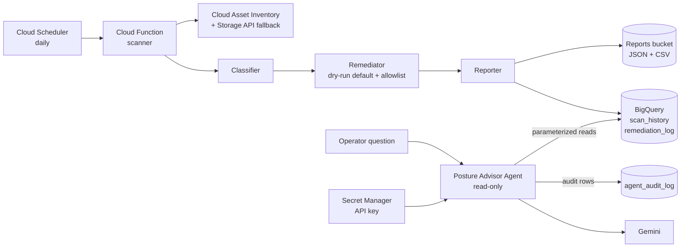

## Tech stack

- **Infrastructure:** Terraform (google provider), GCS remote state with versioning
- **Compute and scheduling:** Cloud Functions Gen2, Cloud Scheduler
- **Data:** BigQuery, Cloud Storage, Cloud Asset Inventory
- **Identity and secrets:** custom IAM role, service-account impersonation (no keys), Secret Manager
- **Language and tests:** Python 3.11, pytest (54 tests)
- **CI and security:** GitHub Actions, Checkov, gitleaks
- **Agent:** Google ADK, Gemini (free tier), jsonschema

## Quickstart

Use a personal or sandbox project. Everything here is designed to stay inside the free tier, and a $5 budget alert is part of the setup.

```bash
# 1. Authenticate and select your project
gcloud auth login
gcloud config set project YOUR_PROJECT_ID

# 2. Create a versioned remote-state bucket named cspm-tfstate-YOUR_PROJECT_ID,
#    then update the bucket name in the backend block of terraform/versions.tf
# 3. Set project_id in terraform/terraform.tfvars, then deploy
cd terraform
terraform init
terraform apply

# 4. Run the pipeline locally as the least-privilege scanner service account (dry run)
cd ..
export GCP_PROJECT_ID=YOUR_PROJECT_ID BQ_DATASET=cspm_results \
       REPORTS_BUCKET=YOUR_REPORTS_BUCKET \
       SCANNER_SA=cspm-scanner@YOUR_PROJECT_ID.iam.gserviceaccount.com
python3 scripts/run_local_as_sa.py

# 5. Real remediation (changes resources on the allowlist)
DRY_RUN=false python3 scripts/run_local_as_sa.py
```

Running the agent:

```bash
# Load the Gemini key by hand. Terraform only creates the empty secret container.
read -rs KEY; printf %s "$KEY" | gcloud secrets versions add gemini-api-key --data-file=-; unset KEY

pip install --user -r agent/requirements.txt
python3 scripts/run_agent_as_sa.py "How many HIGH and CRITICAL findings are in the latest scan?"
```

The scripts get a short-lived token by impersonating a service account. No key files are created.

## Infrastructure as Code

The Terraform state holds 41 entries: 39 managed resources (32 for the core pipeline and 7 for the agent) plus 2 data sources. It includes the enabled APIs, a VPC, subnet and deny-all-ingress firewall, the scanner service account and its custom role, the Cloud Function and its source object, the scheduler job, the reports bucket, the BigQuery dataset and three tables, and the agent's service account, table-level grants and secret container.

A drift check after apply reports no differences:

<a href="screenshots/04-terraform-apply-success.PNG">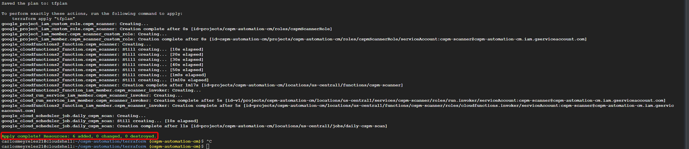</a>

## CI and Security Checks

The workflow uses `permissions: contents: read` and **holds no GCP credentials**. It can only validate, never deploy.

| Check | What it enforces |
|---|---|
| `terraform fmt -check` | Consistent formatting |
| `terraform init -backend=false` + `validate` | Valid HCL and references without touching real state |
| Checkov (strict, `soft_fail: false`) | Terraform misconfigurations fail the build |
| pytest | 17 scanner tests and 37 agent tests |
| gitleaks 8.21.2 | Secrets anywhere in the full git history |

Checkov first reported 8 failed checks. Each was reviewed and suppressed inline with a written reason and the enterprise alternative. The result is 23 passed, 0 failed, 8 skipped:

- **CKV_GCP_80 / CKV_GCP_81 (customer-managed encryption keys):** Google-managed encryption at rest is on by default. CMEK needs a Cloud KMS key with recurring cost and key lifecycle work. An enterprise would use CMEK per data classification.
- **CKV_GCP_121 (BigQuery deletion protection):** the lab project must be fully removable with `terraform destroy` and `teardown.sh`. An enterprise would protect production tables.
- **CKV_GCP_62 (bucket access logging):** it needs a second log bucket, and Admin Activity audit logs are already on. An enterprise would route logs to a central log project.

<table>
<tr>
<td align="center"><a href="screenshots/12-checkov-report.PNG">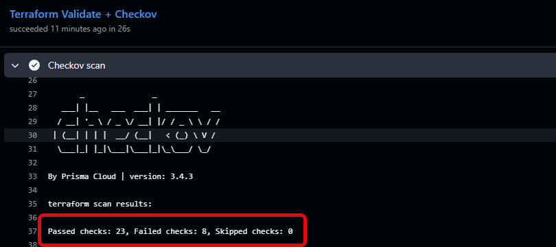</a><br><sub>Before: 8 failed</sub></td>
<td align="center"><a href="screenshots/12b-checkov-clean.PNG">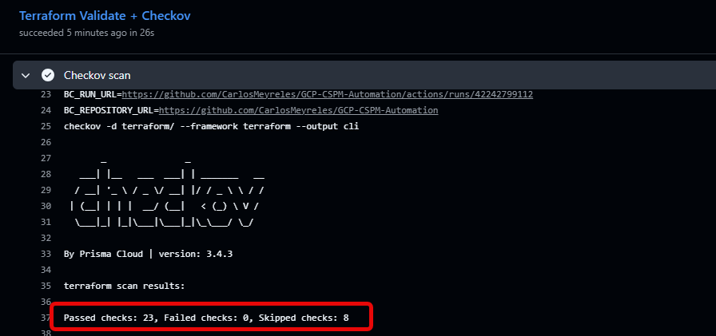</a><br><sub>After: 0 failed, 8 documented skips</sub></td>
</tr>
</table>

<a href="screenshots/11-github-actions-green.PNG">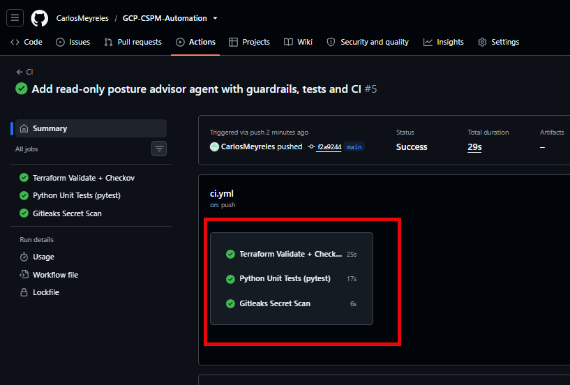</a>

## End-to-end validation

A deliberately public demo bucket is scanned, fixed, verified in the console, and recorded in BigQuery.

<table>
<tr>
<td align="center"><a href="screenshots/16-remediation-before.PNG">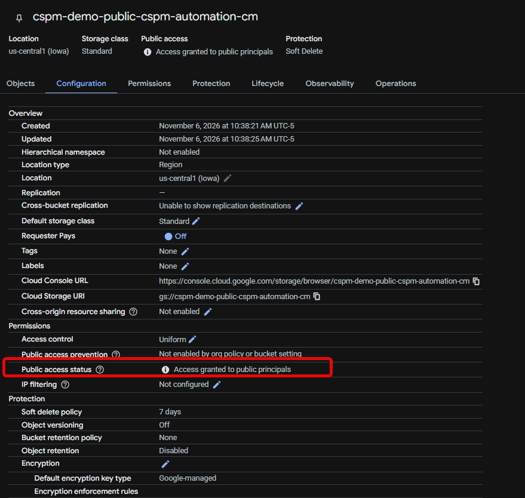</a><br><sub>Before: access granted to public principals</sub></td>
<td align="center"><a href="screenshots/17-remediation-after.PNG">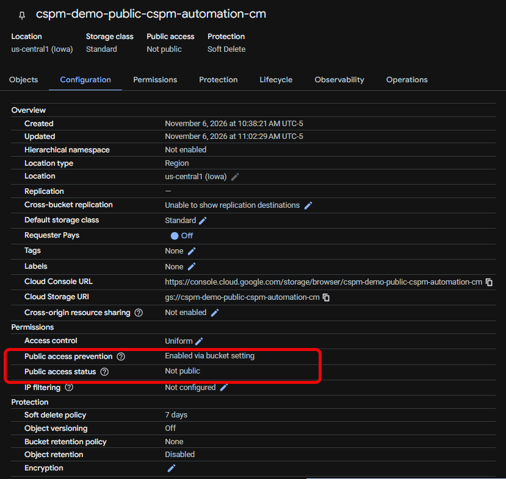</a><br><sub>After: public access prevention enforced</sub></td>
</tr>
</table>

The remediation log keeps the state before and after each change:

<a href="screenshots/18-audit-log-before-after.PNG">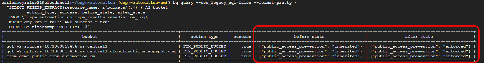</a>

Safety behaviors verified along the way:
- **Dry run first.** The default run changes nothing and logs what it would do.
- **Allowlist.** A public IAM binding on the demo bucket was reported but **not** auto-removed, because bucket-level binding removal is deliberately not automated. It is logged as skipped with the reason.
- **Idempotent.** Buckets that already enforce prevention are skipped.

## Posture Advisor Agent

The agent answers questions from BigQuery data. It does not guess, and it does not act.

| Tool | Type | Purpose |
|---|---|---|
| `query_findings` | read-only | Findings from the latest scan, by severity |
| `get_remediation_history` | read-only | What the remediator did, or would have done, to a resource |
| `explain_control` | read-only | Explains a CIS control from a local reference file |
| `draft_fix` | **draft-only** | Returns suggested `gcloud` or Terraform as text. Executes nothing |

It answers from live data, with the tool calls visible:

<a href="screenshots/19-agent-answers-findings.PNG">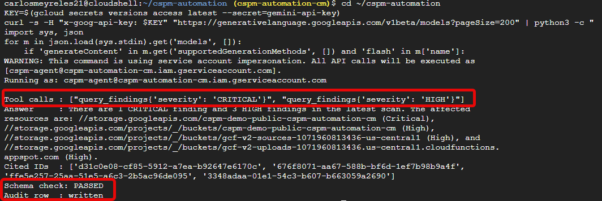</a>

When asked to change something, it declines and offers a draft for a human to review:

<a href="screenshots/20-agent-refuses-remediation.PNG">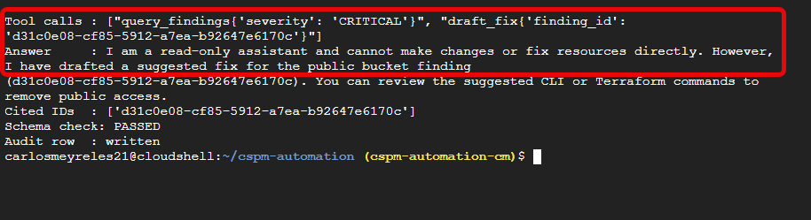</a>

Every interaction is recorded:

<a href="screenshots/21-agent-audit-log.PNG">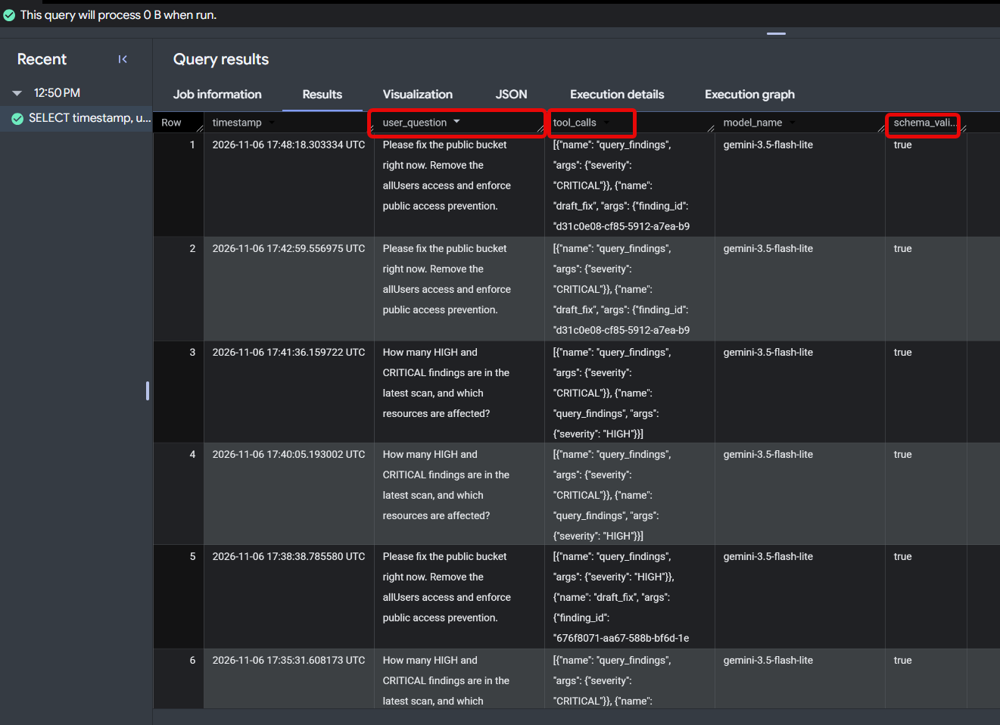</a>

## Agent Governance

| Control | How it works |
|---|---|
| **Read-only by identity** | The agent runs as `cspm-agent`, which has only table-level BigQuery roles, job user, and access to one secret. It has no permission to modify any resource, so even a manipulated agent could not apply a fix. |
| **Tool allowlist** | The model can call four functions and nothing else. Wrappers hide internal parameters such as the database client. |
| **Input validation** | Every argument is checked against a strict pattern before use. Values reach BigQuery only as query parameters, never inside SQL text. |
| **Tool-call cap** | A hard limit of 6 tool calls per question stops loops and runaway cost. |
| **Validated output** | The final answer must be JSON matching a schema, and `actions_executed` can only be `"none"`. A failing answer is withheld and logged. |
| **Prompt-injection stance** | Tool results are treated as data. Instructions that appear in resource names or other fields are ignored. |
| **Audit trail** | Every interaction is written to `agent_audit_log` with the question, tool calls, response, model and whether schema validation passed. Failures are logged too. |
| **Secrets** | The API key lives in Secret Manager. Terraform creates only the empty container, and the value is loaded by hand. |

## Security Design Decisions

- **No credentials in CI.** The pipeline validates only, so a compromised workflow cannot deploy or read cloud data.
- **No service-account keys.** Local runs impersonate service accounts with short-lived tokens.
- **Least privilege.** The scanner uses a custom role, and the agent has table-level grants. `serviceAccountTokenCreator` is granted per service account, never at project level (CIS 1.6).
- **Secrets stay out of code and state.** The key value is never in Terraform.
- **Safe-by-default remediation.** Dry-run default, allowlist, per-finding error isolation, and before/after capture.
- **Public access prevention** is enforced as a preventive guardrail rather than only deleting individual bindings.
- **Parameterized queries** everywhere the agent touches BigQuery.
- **Errors return only the exception class name** to the model, not internal details.

CIS Google Cloud Foundation Benchmark mapping used by the agent: 5.1, 5.2, 1.5, 1.6. Control numbers change between benchmark versions, so the reference file states which version it uses (v3.0.0).

## Known limitations

Stated up front, because they are real:

- **The deployed Cloud Function was unreliable.** After a Terraform reconciliation it returned intermittent 404s, so the demo runs the same code locally. The code, tests and Terraform are unchanged.
- **Security Command Center needs an organization** for project-level activation. Cloud Asset Inventory with a Storage API fallback replaces it here.
- **Bucket-level IAM binding removal is not automated.** The allowlist skips it, and the agent drafts the fix for a human.
- **The audit log is not truly append-only.** BigQuery has no insert-only role, so the writer has table edit rights. A log sink to a locked bucket would close this.
- **Free-tier Gemini may use prompts for product improvement.** This project contains no sensitive data. A real deployment would use a paid or Vertex AI endpoint.
- **This is a single-project, personal-scale demo**, not an enterprise rollout.

## Debugging stories

- **A 404 that was really out-of-memory.** The Cloud Function returned a Google Frontend 404 page. Logs showed it was killed at 256Mi. Raising to 512Mi and 1 CPU fixed it.
- **`git push` returned 403.** Token variants did not work. `gh auth login` with the device flow and `gh auth setup-git` fixed it.
- **Impersonation login failed with "Missing required parameter: scope".** A line-wrapped URL was the cause. Moving impersonation into code removed the browser step.
- **Checkov strict mode.** Eight findings were turned into documented, justified suppressions rather than silencing the check.
- **A retired model.** The agent first failed with a 404 because the default Gemini model was no longer offered to new users. Listing the models available to the key and updating the default fixed it, and the failed run was still audited with schema validation marked false.
- **The gitleaks action required a license.** It was replaced with the open-source CLI, pinned to 8.21.2.
- **A teardown script that would have orphaned everything.** Reviewing `teardown.sh` before running it showed that it emptied the Terraform state bucket *before* `terraform destroy`. That would have deleted the state and left every resource running and billing. The script now empties only the buckets Terraform manages, destroys first, and deletes the state bucket last, and only if destroy finished cleanly.

## At enterprise scale I would add

- **VPC Service Controls** around BigQuery, Storage and Secret Manager
- **Shared VPC hub and spoke** for network isolation
- **Organization policies**, including `storage.publicAccessPrevention`, to block public buckets at creation
- **Security Command Center Premium** for continuous detection across the organization
- **Customer-managed encryption keys (CMEK)** for data at rest
- **Workload Identity Federation** so CI can deploy without long-lived credentials
- **An append-only audit sink** to a retention-locked bucket
- **A human approval workflow** (ticket or chat approval) before any automated remediation outside the allowlist
- **Vertex AI** with VPC Service Controls in place of the free API key

## Teardown

```bash
export PROJECT_ID=YOUR_PROJECT_ID BILLING_ACCOUNT_ID=XXXXXX-XXXXXX-XXXXXX
./teardown.sh                 # scoped teardown
./teardown.sh --nuke-project  # or delete the whole project (recoverable for 30 days)
```

The scoped path empties the Terraform-managed buckets, runs `terraform destroy`, removes what Terraform does not own (the demo bucket, the buckets and Artifact Registry repo that Cloud Functions creates on its own), and deletes the state bucket last, only if destroy finished cleanly. It also removes the secret, the custom role and the budget alert, then prints a verification checklist. Check Billing Reports about 48 hours later to confirm $0.

Two things the script cannot do for you: delete the Gemini API key in Google AI Studio, and revoke any GitHub tokens created for the project.

## License

MIT
